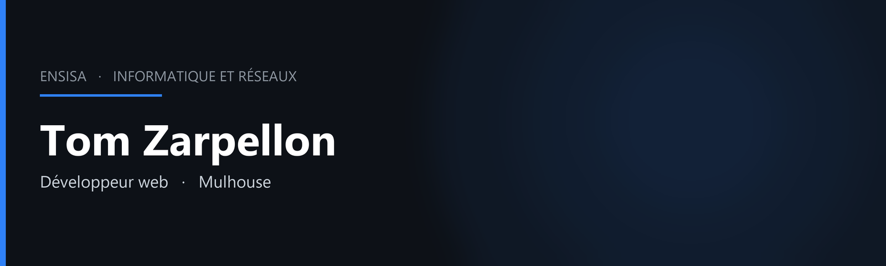

- Comment me joindre :
  - e-mail : [tom.zarpellon@gmail.com](mailto:tom.zarpellon@gmail.com)
  - LinkedIn : [tom-zarpellon](https://www.linkedin.com/in/tom-zarpellon)
  - Instagram : [tom_zarpellon](https://www.instagram.com/tom_zarpellon/)

Étudiant ingénieur en Informatique et Réseaux à l'ENSISA, après un BUT Métiers du Multimédia et de l'Internet à Mulhouse. Je conçois des applications web, des outils métier et des interfaces, du besoin jusqu'à la mise en ligne.

En stage chez AMDL, à Guebwiller, j'ai réalisé un intranet et un CRM, puis un PIM et un outil de gestion commerciale, en React et TypeScript, avec Supabase et un déploiement sur Vercel.

## Compétences

<table>
<tr>
<td>
<b style="font-size:30px">Je maîtrise</b>
</td>
<td>
<b style="font-size:30px">J'apprends</b>
</td>
<td>
<b style="font-size:30px">Déjà utilisé</b>
</td>
</tr>
<tr>
<td>

</td>
<td>
 
 

</td>
<td>

</td>
</tr>
</table>

## Outils que j'utilise

## Projets

**Application mobile** — conçue et publiée sur l'App Store, de l'idée jusqu'à la mise en production.

**Rasso** — application autour des rassemblements automobiles en France : recherche utilisateur, prototype et carte.

**Petly** — conception pour les propriétaires d'animaux : parcours utilisateur et design system.

**CarFit** — landing page HTML, CSS et JavaScript, responsive.

## En dehors du code

